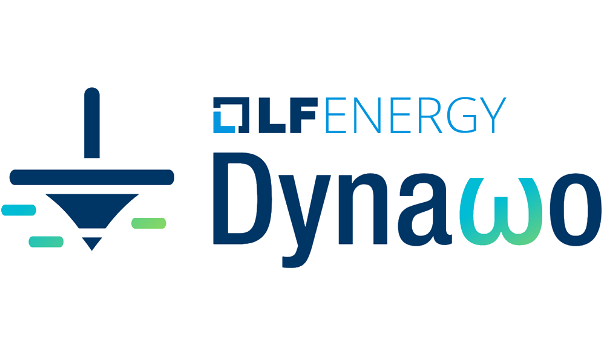
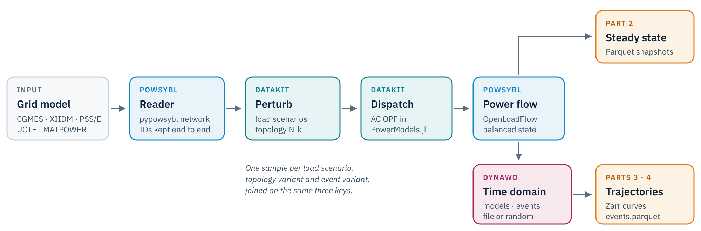

::: {.session-strip}
[15 min]{.chip} [Part 1 of 4]{.chip} [pypowsybl · pypowsybl.dynamic]{.chip}
:::

::: {.goals}
#### In this part

- Place PowSyBl and Dynawo in the GridFM-Datakit pipeline.
- Load a grid, solve a power flow and draw it with pypowsybl.
- Move a grid between exchange formats and see what each one keeps.
- Run a first Dynawo time-domain simulation from Python and plot it.
:::

```{python}
#| echo: false
import sys

sys.path.insert(0, "..")
from helpers import PALETTE, area_diagram, setup

setup()
```

## Two tools from the control room

Both projects started at RTE, the French transmission system operator, and are developed in the open. Operators use them for real operational and planning studies, which is what makes them interesting as a source of training data.

| | **PowSyBl** | **Dynawo** |
|---|---|---|
| What | Framework to model, exchange and simulate grids | Time-domain simulator, RMS (phasor) |
| Core | Java, with the Python binding **pypowsybl** | C++ solver, Modelica models compiled ahead of time |
| Grid formats | CGMES, UCTE, PSS/E, XIIDM, MATPOWER | Reads the grid from PowSyBl |
| Simulations | Load flow (OpenLoadFlow), security analysis, sensitivities, short circuit, remedial action optimizer | Short-term stability (DynaSwing), long-term stability (DynaWaltz), steady state with automata (DynaFlow) |
| Home | [powsybl.org](https://www.powsybl.org), an LF Energy project | [dynawo.github.io](https://dynawo.github.io) |

{width=180} &nbsp;&nbsp;&nbsp; {width=150} &nbsp;&nbsp;&nbsp; {width=150}

## Why GridFM-Datakit integrates them

A foundation model learns what its data shows it. Datakit already produced large steady-state datasets from MATPOWER cases with PowerModels.jl. PowSyBl and Dynawo extend it in three directions.

1. **Industrial grids in.** PowSyBl reads the formats operators exchange every day, so a dataset can start from a realistic network instead of a textbook case.
2. **Industrial-grade physics out.** OpenLoadFlow and Dynawo are the solvers used on real operational studies, which narrows the gap between synthetic data and the field.
3. **Time as a new modality.** Dynawo turns each operating point into a trajectory, and randomized disturbances become a new axis of data augmentation.

{fig-alt="Pipeline from grid model through PowSyBl, datakit perturbation, OPF, power flow, to a steady-state dataset and through Dynawo to trajectories."}

::: {.callout-note title="The same identifiers everywhere"}
Every element keeps the ID it has in the network file, from the PowSyBl network to the Dynawo model mapping and the output tables. That is what lets a configuration file say "disconnect `_GEN____2_SM` at 1 s".
:::

## PowSyBl in a few lines

The IEEE 14-bus case used throughout the dynamic parts ships as an XIIDM file, the native PowSyBl format.

```{python}
import matplotlib.pyplot as plt
import pandas as pd
import pypowsybl as pp

network = pp.network.load("../data/ieee14/IEEE14.iidm")
network.get_generators()[["name", "target_p", "target_v", "max_p", "voltage_regulator_on"]]
```

Every element type is a pandas DataFrame, and every attribute can be updated in place. A load flow with OpenLoadFlow fills in the voltages and the flows.

```{python}
result = pp.loadflow.run_ac(network)
print(result[0].status_text, "in", result[0].iteration_count, "iterations")
network.get_buses()[["v_mag", "v_angle"]].round(2).T
```

PowSyBl models equipment in detail, and OpenLoadFlow can control it. On a copy of the grid, the ratio tap changer of the transformer between buses 4 and 9 starts at its lowest tap and regulates the voltage of bus 9 to 14.3 kV.

```{python}
regulated = pp.network.load("../data/ieee14/IEEE14.iidm")
transformer = "_BUS____4-BUS____9-1_PT"
regulated.update_ratio_tap_changers(
    id=transformer,
    tap=1,
    oltc=True,
    regulated_side="TWO",
    target_v=14.3,
    target_deadband=0.1,
)
regulated.update_ratio_tap_changers(id=transformer, regulating=True)
result = pp.loadflow.run_ac(
    regulated, pp.loadflow.Parameters(transformer_voltage_control_on=True)
)
print(result[0].status_text, "in", result[0].iteration_count, "iterations")

tap = regulated.get_ratio_tap_changers().loc[transformer]
print("tap", tap.tap, "solved at", tap.solved_tap_position)
pd.DataFrame(
    {"base case": network.get_buses().v_mag, "regulated": regulated.get_buses().v_mag}
).loc[["_BUS____9_VL_0"]].round(2)
```

The load flow leaves `tap` at its set value and reports the position it chose in `solved_tap_position`. The base case `network` is untouched, so the rest of this part runs on the original grid.

PowSyBl also draws the grid. The network area diagram shows each voltage level with its flows.

```{python}
#| eval: false
network.get_network_area_diagram()
```

```{python}
#| echo: false
area_diagram(network)
```

## Exchange formats

European operators exchange grid models as **CGMES**, the Common Grid Model Exchange Standard. PowSyBl writes and reads it, as well as its own **XIIDM** format. A round trip shows what each one keeps. It runs on the PEGASE 89-bus case of PGLib, the grid of Part 2, which GridFM-Datakit's PowSyBl reader turns from a MATPOWER file into a pypowsybl network.

```{python}
from pathlib import Path

from gridfm_datakit.network import get_pglib_source_path
from gridfm_datakit.powsybl import load_net

Path("outputs/part1").mkdir(parents=True, exist_ok=True)
grid = load_net(get_pglib_source_path("case89_pegase")).pp_net
grid.save("outputs/part1/pegase89.zip", format="CGMES")
grid.save(
    "outputs/part1/pegase89_cgmes3.zip",
    format="CGMES",
    parameters={"iidm.export.cgmes.cim-version": "100"},
)
grid.save("outputs/part1/pegase89.xiidm", format="XIIDM")

copies = {
    "MATPOWER source": grid,
    "CGMES 2.4.15": pp.network.load("outputs/part1/pegase89.zip"),
    "CGMES 3": pp.network.load("outputs/part1/pegase89_cgmes3.zip"),
    "XIIDM": pp.network.load("outputs/part1/pegase89.xiidm"),
}
pd.DataFrame(
    {
        name: [len(n.get_buses()), len(n.get_generators()), len(n.get_branches()),
               len(n.get_loading_limits())]
        for name, n in copies.items()
    },
    index=["buses", "generators", "branches", "loading limits"],
)
```

A MATPOWER case rates its branches in apparent power. CGMES 2.4.15 holds apparent power limits in its Equipment Operation profile, which PowSyBl does not write for a bus-branch model like this one, so they are lost. CGMES 3 moved them into the core equipment profile and keeps them, but two buses go missing on the way back. XIIDM keeps everything, so that is the file GridFM-Datakit gets in Part 2. A CGMES file from an operator, whose limits are currents, goes in the same way.

## A first Dynawo simulation

`pypowsybl.dynamic` drives Dynawo with three mappings. **Models** attach a dynamic model to a static element, **events** say what happens and when, and **output variables** say what to record. The physical parameters of each model come from a `.par` file, referenced by a parameter set ID.

```{python}
import pypowsybl.dynamic as dyn

models_table = pd.read_csv("../data/ieee14/static_element_dynamic_models.csv")
machines = models_table.query("category_name == 'SynchronousGenerator'")
machines
```

The five machines get a synchronous generator model. Loads and other elements keep Dynawo's default model.

```{python}
models = dyn.ModelMapping()
for row in machines.itertuples():
    models.add_synchronous_generator(
        static_id=row.static_id,
        parameter_set_id=row.parameter_set_id,
        model_name=row.model_name,
    )
```

The disturbance is a 100 ms solid fault on bus 4, cleared without tripping anything.

```{python}
events = dyn.EventMapping()
events.add_node_fault(
    static_id="_BUS____4_TN", start_time=1.0, fault_time=0.1, r_pu=0.0, x_pu=0.01
)

outputs = dyn.OutputVariableMapping()
outputs.add_standard_model_curves(static_id="_BUS____4_TN", variables=["U_value"])
for gen in machines.static_id:
    outputs.add_dynamic_model_curves(
        dynamic_model_id=gen, variables=["generator_omegaPu_value"]
    )
```

The solver settings live in the same `.par` file. `IDAOrder2` is a variable-step solver, fine enough to follow a fault.

```{python}
par = "../data/ieee14/IEEE14.par"
parameters = dyn.Parameters(
    start_time=0.0,
    stop_time=10.0,
    provider_parameters={
        "parametersFile": par,
        "network.parametersFile": par,
        "network.parametersId": "Network",
        "solver.type": "IDA",
        "solver.parametersFile": par,
        "solver.parametersId": "IDAOrder2",
    },
)

simulation = dyn.Simulation()
result = simulation.run(network, models, events, outputs, parameters)
print(result.status())
```

The curves come back as one DataFrame indexed by time.

```{python}
curves = result.curves()
curves.index = (curves.index - curves.index[0]).total_seconds()

fig, (ax_u, ax_w) = plt.subplots(1, 2, figsize=(11, 4))
ax_u.plot(curves.index, curves["NETWORK__BUS____4_TN_U_value"], color=PALETTE[0])
ax_u.set(title="Voltage at bus 4", xlabel="time (s)", ylabel="kV")
for i, gen in enumerate(machines.static_id):
    ax_w.plot(
        curves.index,
        curves[f"{gen}_generator_omegaPu_value"],
        color=PALETTE[i],
        label=gen.strip("_").replace("____", " ").replace("_SM", ""),
    )
ax_w.set(title="Rotor speed", xlabel="time (s)", ylabel="pu")
ax_w.legend(ncols=2)
fig.tight_layout()
```

The fault collapses the voltage at bus 4, and the rotor speeds of the machines swing, then settle. This is one trajectory. Parts 3 and 4 produce thousands of them, each from a different operating point and a different disturbance.

## Your turn

::: {.callout-tip .exercise title="Exercise · Trip a generator"}
Replace the fault by the disconnection of generator 2 at 1 s with `events.add_disconnection(static_id=..., start_time=...)`. Run the simulation for 30 s and plot the rotor speed of generator 1. How does the response differ from the fault?
:::

::: {.callout-note .solution collapse="true" title="Show a solution"}
```{python}
#| tags: [solution]
network = pp.network.load("../data/ieee14/IEEE14.iidm")
pp.loadflow.run_ac(network)

trip = dyn.EventMapping()
trip.add_disconnection(static_id="_GEN____2_SM", start_time=1.0)
parameters = dyn.Parameters(
    start_time=0.0,
    stop_time=30.0,
    provider_parameters=parameters.provider_parameters,
)
result = simulation.run(network, models, trip, outputs, parameters)

curves = result.curves()
curves.index = (curves.index - curves.index[0]).total_seconds()
ax = curves["_GEN____1_SM_generator_omegaPu_value"].plot(color=PALETTE[0])
ax.set(title="Rotor speed of generator 1 after tripping generator 2",
       xlabel="time (s)", ylabel="pu");
```
:::

Losing a machine is a lasting power imbalance. The speed drops and settles at a new value set by the governors, where a cleared fault leaves the system where it started.

::: {.callout-note title="Next"}
[Part 2](02-steady-state.qmd) feeds the PEGASE grid through PowSyBl into datakit and builds a steady-state dataset.
:::
